<p align="center">
  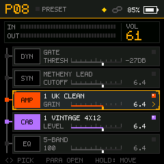
  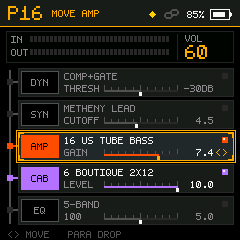
  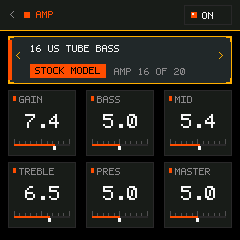
</p>
<p align="center">
  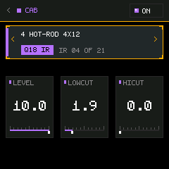
  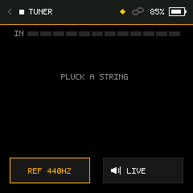
  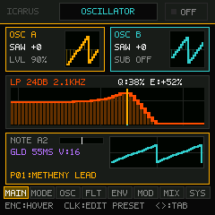
  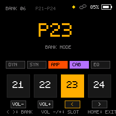
</p>

<h1 align="center">Icarus</h1>

<p align="center"><b>An open-source modular firmware, DSP engine, and analog guitar synthesizer for the M-VAVE / Donner Pocket AMP.</b><br>
Pick your tone, audition in the desktop emulator, customize in the Web Editor, and flash directly over Web MIDI.<br>
Free software (GPL-3.0-only), built on <a href="https://github.com/hugelton/Pendel">Pendel</a>, <a href="https://github.com/w0ts/optimist">Optimist</a>, and clean-room DSP models (see <a href="#credits">Credits</a>).</p>

> [!WARNING]
> ## ⚠️ Independent Interoperability Project — Not Affiliated with M-VAVE or Donner
> This is an independent, unofficial interoperability and research project for devices running the JieLi AC791N (pi32v2) SoC. It contains **no M-VAVE/Donner firmware binaries, amp captures, cabinet impulse responses, or preset banks**, and it does not redistribute any proprietary vendor data. Factory stock amp voicings and IRs are never distributed; they are read read-only from your own device flash partition at runtime. Check the vendor's EULA/terms before any public distribution.

> [!CAUTION]
> **Work in progress, no warranty, use at your own risk.** Icarus runs on real Pocket AMP hardware with verified memory boundaries (`pa_flash_rw_ok()`), but flashing custom firmware writes directly to your device's physical SPI-NOR flash memory. An interrupted flash can leave a unit in bootloader mode. **Always back up first**, ensure your battery is charged, and read [Getting back](#getting-back) before flashing.

---

## Everything happens in your browser & workbench

Use **Google Chrome or Microsoft Edge** (with native Web MIDI enabled) and a standard USB-C data cable connected directly to your computer.

| Tool | What it does |
|---|---|
| [**Icarus Web Editor**](custom-fw/web/Icarus_Web_Editor.html) | **Flash and edit without compiling.** Connect via Web MIDI SysEx to install firmware packages (`.fwsc`), compare the unit's flash with a file, edit presets, load amp captures and cabinets, and restore the original firmware from your own unmodified `Pocket AMP.fwsc`. |
| [**Desktop HIL Emulator**](custom-fw/emu/) | **The real firmware running on your PC.** Streams live low-latency guitar audio through your USB ASIO interface into the identical C firmware DSP engine. Features a 240×240 LCD front panel, live oscilloscope, peak meters, drag-and-drop `.nam` and `.wav` IR hot-loaders, and 15 dry guitar DI auditioning captures. |
| [**WebAssembly Workbench**](custom-fw/wasm/) | **Browser-native audio simulation.** Runs the portable audio core jack (`pa_audio_core_process_half`) compiled to WebAssembly via AudioWorklet. |

---

## What it does

- **Five reorderable effect blocks**: Change signal routing dynamically on the fly (`DYN → SYNTH → AMP → CAB → EQ` by default). The chain keeps eight slots for preset and SysEx compatibility; the MOD, DELAY and REVERB slots are retired.
- **WaveNet Neural Amp Modeling**: Real-time Float32 WaveNet neural inference for NAM A2 captures, running on CPU Core 1 via lock-free SMP handoff.
- **Icarus Analog Guitar Synthesizer**: Strictly monophonic pitch-tracking analog synthesizer featuring zero-delay feedback (ZDF) resonant ladder filtering, dual band-limited oscillators, sub-octaves, waveshaping, and ADSR envelope followers (mono single-note tracking; polyphonic chords are not supported).
- **Partitioned FIR Cabinet Convolution**: Up to 2048 taps of stereo impulse response processing with hardware vector accelerator offload.
- **Chromatic Tuner & Live Bank Mode**: YIN-based needle tuner with selectable reference pitch (430–450 Hz) and 4-slot live performance banks.
- **Bluetooth LE MIDI**: Wireless parameter control and footswitch integration (e.g. Chocolate Plus) via the integrated open Optimist BLE stack.

---

## Audio engine and effect blocks

The default signal order is `DYN → SYNTH → AMP → CAB → EQ`. Any block can be moved anywhere in the chain using **Moving Mode** (`PARA HOLD 1.6s`), and bypassed nodes dynamically reclaim memory and CPU cycles.

| Block | Models & algorithms in current source |
|---|---|
| **DYN** | **GATE**, **BOOST+GATE**, **COMP+GATE**, **AI GATE MS**, **COMP**. Dynamic noise reduction with hysteresis, soft-knee RMS compression, peak limiting, and makeup gain. |
| **SYNTH** | **Icarus Guitar Synthesizer**. Topology-preserving 4-pole resonant filter, dual morphing PolyBLEP oscillators (saw/square/triangle), sub-oscillator, glide, LFO, and fast envelope followers. |
| **AMP / NAM** | **Float32 WaveNet Inference** for NAM A2 captures, including embedded A2-Lite profiles. Offloaded to Core 1 in ~1,360 µs of the 1,451 µs block deadline. |
| **CAB** | **Partitioned FIR Convolution** (up to 2048 taps) with low-cut, high-cut, and level controls. Supports clean-room synthetic default cab and user IR loading. |
| **EQ** | **5-Band Graphic EQ**, **Low/High Cut**, **Parametric-3** (low shelf, sweepable mid, high shelf). Double-buffered DF2T biquad structures on hardware FPU. |

> [!NOTE]
> Legacy auxiliary blocks (standalone DRIVE, MOD, DELAY, REVERB) were retired from the active chain to dedicate memory and real-time processing budget to the dual-oscillator resonant guitar synthesizer and neural amp models. Legacy MIDI CC commands for retired slots are safely handled without effect.

---

## Icarus Guitar Synthesizer

The built-in guitar synthesizer (`PA_SLOT_SYNTH`) transforms electric guitar input into vintage analog synth textures with dedicated interactive laboratory submenus:

> [!IMPORTANT]
> **Monophonic (Mono) Only — Not Polyphonic**
> The Icarus Synthesizer is designed exclusively for **single-note lead lines, riffs, and basslines**. Pitch tracking utilizes an ultra-low-latency YIN fundamental pitch follower tuned for clean monophonic tracking. **It is not polyphonic** — playing chords or multiple simultaneous strings will produce tracking artifacts. For the cleanest tracking, play single notes with a firm pick attack.

<p align="center">
  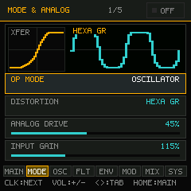
  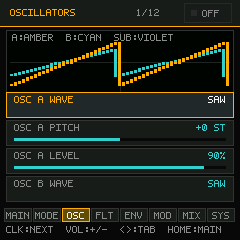
  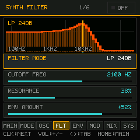
</p>
<p align="center">
  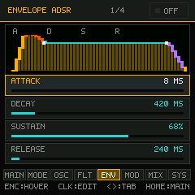
  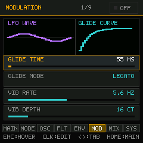
  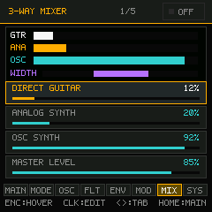
</p>

- **Mode & Waveshaping (`MODE`)**: Nonlinear transfer curves (Tube, Fuzz, Rectifier, Foldback) with input drive gain and real-time transfer function visualization.
- **Dual Morphing Oscillators (`OSC`)**: PolyBLEP anti-aliased saw, square, and triangle oscillators with independent detune, pulse width, and sub-octave generator on a dual-beam oscilloscope.
- **4-Pole Resonant Ladder Filter (`FLT`)**: Zero-delay feedback (ZDF) 24 dB/oct low-pass ladder filter with interactive 2D Bode plot and resonance tracking.
- **ADSR Envelope Follower (`ENV`)**: 4-stage vector envelope follower with attack, decay, sustain, release vertices and transient onset detection.
- **Modulation & Glide (`MOD`)**: Multi-waveform LFO (Sine, Triangle, Square, Saw, Sample & Hold) and exponential portamento pitch glide curves.
- **Studio Mixer & Spread (`MIX`)**: 3-channel level control (Dry Guitar, Analog Preamp, Synth Core) with stereo field widening.
- **Pitch Following**: Fast YIN-derived fundamental pitch tracking with hysteresis gate and onset transient detector (`custom-fw/src/effects/icarus/icarus_pitch.c`).
- **12 Factory Presets**: Instant access to classic leads, bass synths, filter sweeps, and ambient monophonic waveshaper textures.

---


## Your first install

### 1. Back up first
1. Connect the Pocket AMP to your computer with a USB-C data cable and power the unit ON.
2. Open [`custom-fw/web/Icarus_Web_Editor.html`](custom-fw/web/Icarus_Web_Editor.html) in Chrome or Edge.
3. Click **Connect USB / MIDI**.
4. Keep an unmodified `Pocket AMP.fwsc` from the vendor's download page: the editor needs it to restore the original firmware. For a complete, byte-for-byte image of your unit's flash, use the download-mode dump described in [RECOVERY.md](RECOVERY.md); the Web Editor does not make one.

### 2. Install Icarus
1. Under **Firmware update** in the Web Editor, pick `Icarus_0.10.fwsc` from the [release](https://github.com/28spawn/Icarus/releases) (or the `Icarus.fwsc` your own build writes).
2. Click **Install this firmware**.
3. The editor transfers the image over USB MIDI SysEx. The running firmware verifies the container signature and memory bounds, stages the update loader into SRAM, and writes the application partition.
4. The unit will reboot automatically into Icarus.

---

## Getting back (Restoring stock firmware)

If you ever wish to return to the factory stock firmware:
- **One-Click via Web Editor**: Connect in [`custom-fw/web/Icarus_Web_Editor.html`](custom-fw/web/Icarus_Web_Editor.html), pick your own unmodified `Pocket AMP.fwsc` (it is checked by its SHA-256; this project does not ship it) and click **Restore the original firmware**.
- **Hardware Mask-ROM Recovery**: If a firmware update was interrupted or flash was corrupted, the unit's built-in bootloader (`WL82 UBOOT1.00`) can be entered manually:
  1. Hold **`HOME` + `PARA` simultaneously for 2 seconds** while powered on, or power on while forcing ROM download mode via USB data lines.
  2. The unit enumerates on USB as `WL82 UBOOT1.00`.
  3. Flash your backup or stock firmware using the emergency procedure detailed in [RECOVERY.md](RECOVERY.md).

---

## Controls and user guide

### 1. Front-Panel Buttons & Gestures

| Gesture | Function |
|---|---|
| **`HOME` (Tap)** | **Universal Home**: Returns to the main home screen from any editor. When on the Home screen, opens the **Settings Menu** (Global EQ, Display Grid/List view, footswitch mappings, system information, and factory reset). |
| **`HOME` (Hold 1.5 s)** | **Toggle Stomp / Preset Mode**: Switches the main screen between **PRESET Mode** and **STOMP Mode** (buttons act as instant on/off pedals). |
| **`PARA` (Rotate)** | **Navigate**: Moves the cursor across the effect blocks in the signal chain. Inside menus, adjusts parameter values. |
| **`PARA` (Click)** | **Edit Block**: Opens the deep parameter editor for the highlighted effect block. Click again inside the editor to toggle between selecting parameters and editing values. |
| **`PARA` (Hold 1.0 s)** | **Save Preset**: Opens the "Save to" dialog to store the current tone, edit preset names, or copy settings to slots `P01`–`P80`. |
| **`PARA` (Hold 1.6 s)** | **Reorder Signal Chain (Moving Mode)**: Lifts the highlighted block. Rotate `PARA` left or right to move the block anywhere in the chain. Click `PARA` to drop it into place. |
| **`<` / `>` (Tap)** | Changes current preset down/up (`P01` .. `P80`). Inside editors, navigates parameters. |
| **`VOL-` / `VOL+` (Tap)** | Adjusts master device output volume with an on-screen level overlay. |

### 2. Quick-Access Key Combinations (Chords)

Press the following button pairs simultaneously from the home screen:

| Key Combination | Shortcut Target | Description |
|---|---|---|
| **`VOL-` + `VOL+`** | **Chromatic Tuner** | High-precision needle tuner, detected note, pitch frequency in cents, and selectable Reference Pitch (430–450 Hz). Toggle between MUTE and LIVE pass-through. |
| **`<` + `>`** | **Live Bank Mode** | Groups presets into 4-slot performance banks (`P01-P04`, `P05-P08`, etc.). Switch slots instantly with single button presses. |
| **`HOME` + `VOL+`** | **Icarus Synth** | Direct shortcut into the Icarus analog synthesizer laboratory interface. |
| **`HOME` + `PARA` (Hold 2 s)** | **Manual ROM Download Mode** | Hardware shortcut to reboot directly into mask-ROM USB download mode for low-level recovery. |

---

## Build it on your computer

For developers building firmware images, running regression test suites, or developing new DSP blocks on Windows:

### Prerequisites
- **Windows 10/11** with PowerShell 5.1 or PowerShell 7.
- **Python 3.10+** on `PATH` with `numpy`, `sounddevice` and `soxr` (for the desktop emulator): `python -m pip install -r custom-fw/emu/requirements.txt`.
- **LLVM / Clang for host builds** (`clang.exe` on `PATH`, e.g. via LLVM-MinGW).
- **JieLi pi32v2 toolchain for target builds** (`clang.exe`, `pi32v2-ld.exe`, `llvm-objcopy.exe`). The script searches `$env:PI32_ROOT` and `C:\JL\pi32`.

### Master Checked Build
From the repository root:

```powershell
powershell -ExecutionPolicy Bypass -File "custom-fw/build.ps1"
```

The build is a straight line where every stage is strictly checked (`Invoke-Checked`):
1. **Host Verification**: Compiles and executes unit tests (`test_dsp_chain`, `test_tuner`, `test_reclaim`, `test_envelope`, `test_filter`, `test_pitch`, etc.).
2. **pi32v2 Cross-Compilation**: Compiles all firmware modules with `-target pi32v2 -mcpu=r3 -O2`, links with group scanning (`libcompiler_rt.a`, `libm.a`, `libc.a`), and extracts memory sections (`.text`, `.ram_text`, `.c1_text`, `.ramfn`, `.flashfn`, `.data`) to exact calculated load addresses.
3. **Effect & Input Matrix**: Compiles the native emulator DLL and runs automated permutation sweeps across the effect blocks and button gestures.
4. **Vendor-Free Packaging**: Uses `custom-fw/tools/onyx_pkg_make.py` and the MPL-2.0 `onyx_loader.bin` to construct signed `.fwsc` and `.ufw` containers from scratch without proprietary vendor binaries.

To build with Bluetooth LE enabled:
```powershell
powershell -ExecutionPolicy Bypass -File "custom-fw/build.ps1" -BLE
```

#### Bluetooth LE build in one step

The published releases are built with the radio off. To make the Bluetooth build for your own unit, double-click `Build-Icarus-BLE.bat` in the repository root (or download just `Build-Icarus-BLE.ps1` and run it: it clones the repository next to itself). The script:

1. checks for Git, Python 3.10+ with `numpy`, the LLVM-MinGW `clang` and the JieLi pi32v2 toolchain, and offers to install whatever is missing (winget, pip, and JieLi's own installer from JieLi's server);
2. updates the sources to the latest `main` (only when the clone is on `main` with no local changes; `-NoUpdate` skips this);
3. runs the full checked build with `-BLE` and prints the path and SHA-256 of the package it built (`custom-fw\Icarus_BLE.fwsc`, a git-ignored file; the tracked release folder is put back to its committed state).

`-CheckOnly` stops after the requirement checks; `-Yes` answers every install question with yes. The resulting image enables the radio transmitter: it is for your own unit, and its use must follow your local radio regulations.

### Running the Desktop Emulator
```powershell
powershell -ExecutionPolicy Bypass -File "custom-fw/emu/run_emu.ps1"
```
Or double-click `Start-Emulator.bat` in the repository root (`Start-WASM-Workbench.bat` starts the WebAssembly workbench). Open `http://localhost:8080` in your browser to interact with the live virtual front panel and stream real guitar audio through the DSP engine.

---

## Repository map

```text
custom-fw/
  include/       Firmware interfaces, hardware contracts, and configurations
  src/           Board support, DSP, effects, WaveNet/NAM, audio core, and UI
  test/          C and Python regression suites, filter/pitch unit tests
  emu/           Native desktop emulator DLL, PortAudio server, and web frontend
  wasm/          WebAssembly audio worklet build and test workbench
  tools/         Build, packaging, QA gates, recovery, and asset generation
  web/           Icarus Web Editor (Web MIDI installer, librarian, flasher)
  build.ps1      Checked Windows build and packaging pipeline
  app.ld         AC791N linker script and memory layout
ARCHITECTURE.md  Module map, call graphs, concurrency, and execution model
TEST-PROTOCOL.md Hardware QA gate, verification protocol, and recovery drills
LICENSING.md     Detailed licenses, third-party provenance, and build journey
NOTICE.md        Attribution scope and clean-room boundaries
RECOVERY.md      Hardware ROM recovery, unbricking schematics, and tools
```

---

## Credits

Icarus stands on the open-source firmware, DSP, and reverse-engineering work of the community:

- **[Pendel](https://github.com/hugelton/Pendel) & [pendel-bsp](https://github.com/hugelton/pendel-bsp)** by Leo Kuroshita (@kurogedelic), Hügelton Instruments: The update loader architecture, package generator (`pa_pkg_make.py` / `onyx_pkg_make.py`), and hardware abstraction layer (MPL-2.0 & GPL-3.0-only).
- **[Optimist](https://github.com/w0ts/optimist)** by hdavid and contributors: The open Bluetooth Low Energy MIDI stack for the AC791N / WL82 radio, GATT/ATT profiles, and hardware register facts (GPL-3.0-only OR MPL-2.0).
- **Jonas Hemmersbach**: Contribution of authentic clean electric guitar dry direct-input (DI) recordings (chords, licks, riffs) for emulator auditioning and tone evaluation in `custom-fw/emu/samples/`.
- **[Neural Amp Modeler (NAM)](https://github.com/sdatkinson/neural-amp-modeler)** by Steven Atkinson: The open WaveNet neural network architecture and training methodologies for guitar amplifier modeling.
- **YIN Pitch Detection**: Alain de Cheveigné and Hideki Kawahara (2002), for the fundamental pitch tracking algorithm used in the tuner and synth pitch follower.
- **Audio EQ Cookbook**: Robert Bristow-Johnson, for the reference parametric and shelving biquad filter equations.
- **Moog Filter Modeling**: Stilson & Smith (1996) and Antti Huovilainen (2004), for the zero-delay feedback resonant ladder filter topology.
- **JieLi Technology (Zhuhai Jieli Technology Co., Ltd.)**: For the public AC79 SDK and register definitions (Apache-2.0).

*Unofficial: Not made, endorsed, or supported by M-VAVE or Donner. M-VAVE, Donner, JieLi, Roland, Boss, and other product names are trademarks of their respective owners and are referenced solely to describe functional and acoustic behavior.*

---

## License and contributing

- **Code**: Licensed under the **GNU General Public License v3.0 only** (`GPL-3.0-only`, full text in [LICENSE](LICENSE)).
- **Dual-Licensed & Permissive Modules**: The Bluetooth LE stack is licensed under `GPL-3.0-only OR MPL-2.0`, and the update loader components are licensed under `MPL-2.0` per Section 3.3.
- **Third-Party Details**: Complete provenance, commit pins, and licenses are recorded in [LICENSING.md](LICENSING.md) and [NOTICE.md](NOTICE.md).

Contributions are welcomed under GPL-3.0-only. Review [ARCHITECTURE.md](ARCHITECTURE.md) and ensure all host regression suites pass (`powershell -File custom-fw/build.ps1`) before submitting pull requests.
